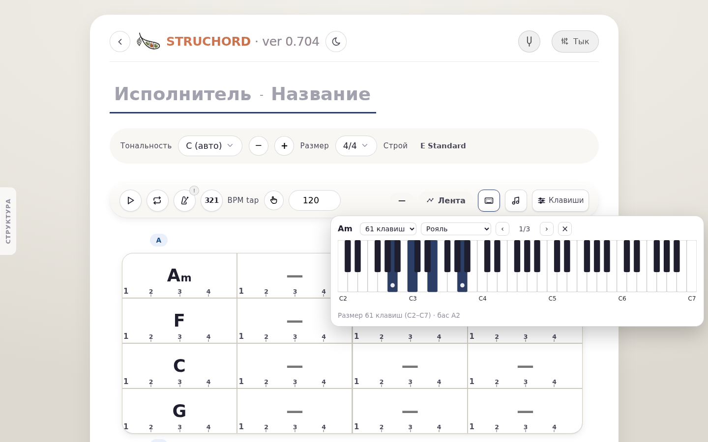
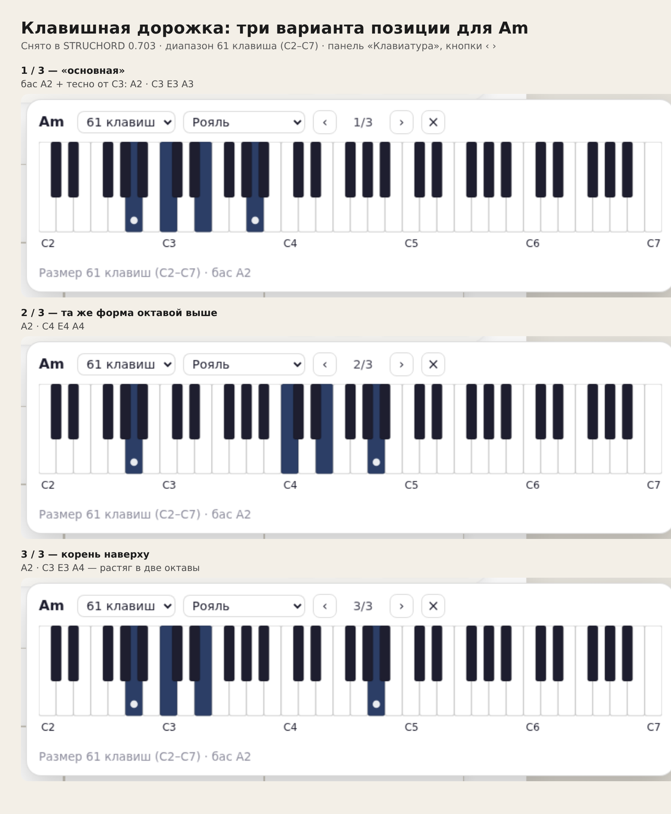
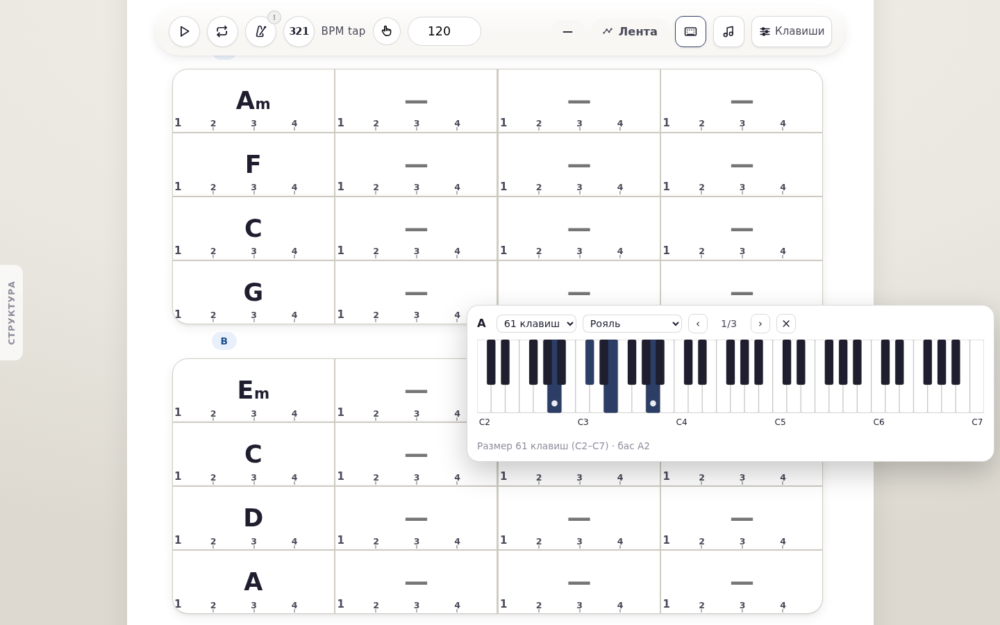
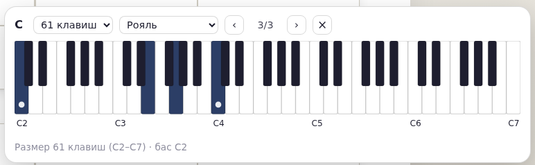

# Клавишные дорожки: как сейчас предлагаются позиции аккорда (0.703)

Разбор по просьбе владельца: «покажите, как сейчас работает» — какие варианты позиции
предлагаются на реальных аккордах, почему именно эти, как переключаются и что видно на экране.
Код не менялся: это съёмка текущего поведения и объяснение по коду.

## На чём смотрели

| Что | Значение |
|---|---|
| Песня | секция A: **Am F C G**, секция B: **Em C D A** — по одному аккорду на такт |
| Дорожка | одна клавишная, диапазон **61 клавиша (C2–C7)**, тембр «Рояль» |
| Окно | панель «Клавиатура» из полосы воспроизведения |
| Как получали варианты | нажимали **›** до возврата на первый вариант; ноты читали с самой картинки (подсвеченные клавиши), а не из модели |
| Длительность прогона | 57,4 секунды звучания, 8 аккордов подряд |
| Ошибки JavaScript | нет |



## Что видно на экране

Панель висит под кнопкой «Клавиатура» в полосе воспроизведения. В шапке: название аккорда,
размер клавиатуры, тембр, кнопки **‹ 1/3 ›** и закрытие **×**. На клавиатуре подсвечены ноты
аккорда, белая точка стоит на корне. Внизу подпись: `Размер 61 клавиш (C2–C7) · бас A2`.

## Сколько вариантов и какие

У всех восьми аккордов — **ровно три** варианта, счётчик `1/3 … 3/3`. Ноты (бас — первая):

| Аккорд | 1/3 | 2/3 | 3/3 |
|---|---|---|---|
| Am | A2 C3 E3 A3 | A2 C4 E4 A4 | A2 C3 E3 A4 |
| F | F2 C3 F3 A3 | F2 C4 F4 A4 | F2 C3 A3 F4 |
| C | C2 C3 E3 G3 | C2 C4 E4 G4 | C2 E3 G3 C4 |
| G | G2 D3 G3 B3 | G2 D4 G4 B4 | G2 D3 B3 G4 |
| Em | E2 E3 G3 B3 | E2 E4 G4 B4 | E2 G3 B3 E4 |
| D | D2 D3 F#3 A3 | D2 D4 F#4 A4 | D2 F#3 A3 D4 |
| A | A2 C#3 E3 A3 | A2 C#4 E4 A4 | A2 C#3 E3 A4 |

Второй **C** (первый такт секции B) пришёл уже со счётчиком **3/3** и теми же нотами
`C2 E3 G3 C4` — см. раздел «Выбор живёт за аккордом».

Три варианта для Am рядом (кадры `chord-1-Am-v0`, `chord-1-Am-v1`, `chord-1-Am-v2`):



## Почему именно эти варианты

Правила взяты из кода `generateKeysVoicings` (строки 31648–31711 `STRUCHORD.html`) и
подтверждены номерами с картинки.

1. **Бас** — первая нота корня от самой низкой клавиши диапазона. При 61 клавише это A2,
   при 88 — уже A0.
2. **Правая рука** — тоны аккорда, каждый на первое место **от C3 вверх** (ниже нельзя,
   выше C6 — не поднимаем). Поэтому «основная» позиция у всех аккордов прижата к C3,
   независимо от размера клавиатуры.
3. **2/3** — та же позиция, сдвинутая на октаву вверх.
4. **3/3** — первый тон (корень) уходит на октаву вверх. В коде это подписано «первое обращение»,
   но по факту это **корень наверху**: у F видно, что ушёл именно корень F3, хотя нижней нотой
   правой руки был C3.
5. **Варианта «на октаву ниже» нет никогда.** Тоны и так стоят над C3, сдвиг вниз возвращает их
   туда же — вариант совпадает с первым, и программа выбрасывает повтор.
6. **Варианта «ближайший к предыдущему аккорду» тоже нет.** В коде он есть, но панель всегда
   спрашивает позиции **без** предыдущего аккорда (строка 32020), поэтому он не строится.

Размер клавиатуры — единственная ручка, которая меняет ответ. Замер на одном и том же Am:

| Размер | Границы | Вариантов | 1/3 |
|---|---|---|---|
| 25 клавиш | C3–C5 | **2** | A3 C4 E4 A4 |
| 37 клавиш | C2–C5 | 3 | A2 C3 E3 A3 |
| 49 клавиш | C2–C6 | 3 | A2 C3 E3 A3 |
| 61 клавиша | C2–C7 | 3 | A2 C3 E3 A3 |
| 76 клавиш | A1–G7 | 3 | **A1** C3 E3 A3 |
| 88 клавиш | A0–C8 | 3 | **A0** C3 E3 A3 |

На 25 клавишах третий вариант пропадает: он совпадает с первым. На 76 и 88 клавишах правая рука
остаётся у C3, а бас уезжает на A1 и A0 — растяг в три-четыре октавы.

## Как переключаются

- Кнопки **‹** и **›** в шапке панели, между ними счётчик `1/3`. Листают **по кругу**:
  с `1/3` кнопка **‹** уводит на `3/3` (проверено).
- Клавиш-стрелок нет: только мышь/палец по кнопкам. **Esc** и **×** закрывают окно.
- Панель показывает **последний сыгранный аккорд**, а не выбранную ячейку: клик по ячейке F
  в сетке название в панели не меняет. Пока песня не играла, панель показывает первый аккорд
  дорожки (у нас — Am).
- После остановки панель остаётся на последнем аккорде песни (у нас — A):



### Выбор живёт за аккордом, а не за тактом

В песне два такта с **C** (третий такт секции A и первый такт секции B). На первом C поставили
`3/3` и не стали возвращать. Второй C пришёл уже с `3/3` и теми же нотами — см. `chord-6-C-remembers.png`:



Значит, выбор запоминается **по имени аккорда**: все Am в песне звучат одинаково, все C — одинаково.

## Что из этого следует для дизайна (наблюдения, без решений)

- Три варианта — это **не обращения**: два октавных сдвига и один «корень наверху».
  Настоящих обращений (C E A, E A C при басе A2) в списке нет.
- Между `1/3` и `2/3` рука прыгает **на целую октаву** (C3 → C4). Промежуточной тесной позиции нет.
- Позиция не зависит от диапазона: на 88 клавишах правая рука всё та же, а бас уезжает на A0.
- Один вариант на весь аккорд в песне: если в разных местах нужен разный рисунок — сейчас нельзя.
- В сетке клавишная дорожка ничем не помечена (решение владельца от 2026-10-28): признак — только
  панель и строка микшера.

Вопросы к следующему шагу (R8 — до кода): нужны ли настоящие обращения и тесные позиции вместо
октавных копий; привязывать ли позицию к диапазону дорожки или к регистру соседних аккордов;
нужно ли плавное голосоведение «ближайшая к предыдущему»; нужен ли выбор позиции отдельно
по тактам; какие подписи дать вариантам вместо `1/3`.

## Проверки

| Набор | Результат |
|---|---|
| `dev/tests/keys-voicings-ranges-0703.js` (новый) | **6 / 6 PASS** |
| `dev/tests/keys-voicings-demo-0703.js` (новый, съёмка) | 8 аккордов, 24 кадра, ошибок JavaScript 0 |
| Числа замеров | `measure.json` (аккорды и варианты), `ranges.json` (размеры клавиатуры) |

Что проверяют 6 пунктов: у Am на 25 клавишах — 2 варианта с точными нотами; на 61 — 3 варианта
с точными нотами; на 88 — бас A0 и по-прежнему 3 варианта; **‹** с `1/3` уводит на `3/3`;
клик по ячейке F не меняет аккорд в панели; ошибок JavaScript нет.

## Как повторить

```bash
cd /home/user/STRUCHORD
python3 -m http.server 8000 --bind 0.0.0.0 &          # откуда браузер берёт страницу
PUPPETEER_EXECUTABLE_PATH=/tmp/chromium LD_LIBRARY_PATH=/tmp/al2023/lib NODE_PATH=node_modules \
  node dev/tests/keys-voicings-ranges-0703.js          # проверки (6/6)
PUPPETEER_EXECUTABLE_PATH=/tmp/chromium LD_LIBRARY_PATH=/tmp/al2023/lib NODE_PATH=node_modules \
  node dev/tests/keys-voicings-demo-0703.js            # съёмка кадров этой папки (~70 c)
```

## Кадры этой папки

| Кадр | Что на нём |
|---|---|
| `00-montage-am.png` | три варианта Am рядом с подписями |
| `00-screen-full.png` | экран целиком в начале песни, панель открыта |
| `99-screen-stopped.png` | экран после остановки: панель на последнем аккорде |
| `chord-1-Am-v0.png`, `chord-1-Am-v1.png`, `chord-1-Am-v2.png` | Am, варианты 1/3, 2/3, 3/3 |
| `chord-2-F-v0.png`, `chord-2-F-v1.png`, `chord-2-F-v2.png` | F, 1/3, 2/3, 3/3 |
| `chord-3-C-v0.png`, `chord-3-C-v1.png`, `chord-3-C-v2.png` | C (секция A), 1/3, 2/3, 3/3 |
| `chord-4-G-v0.png`, `chord-4-G-v1.png`, `chord-4-G-v2.png` | G, 1/3, 2/3, 3/3 |
| `chord-5-Em-v0.png`, `chord-5-Em-v1.png`, `chord-5-Em-v2.png` | Em, 1/3, 2/3, 3/3 |
| `chord-6-C-remembers.png` | второй C пришёл с 3/3 — выбор помнится за аккордом |
| `chord-7-D-v0.png`, `chord-7-D-v1.png`, `chord-7-D-v2.png` | D, 1/3, 2/3, 3/3 |
| `chord-8-A-v0.png`, `chord-8-A-v1.png`, `chord-8-A-v2.png` | A, 1/3, 2/3, 3/3 |
| `measure.json`, `ranges.json` | числа: ноты вариантов по аккордам и по размерам клавиатуры |
