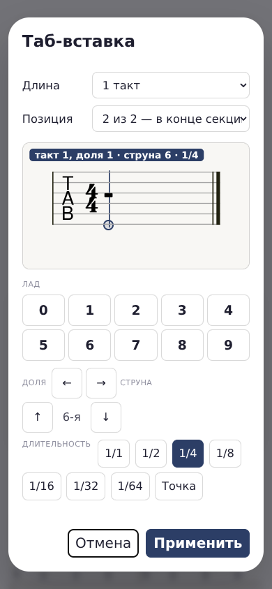
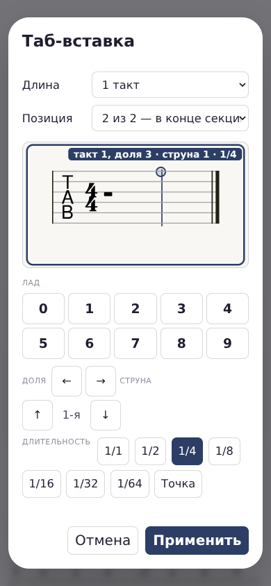
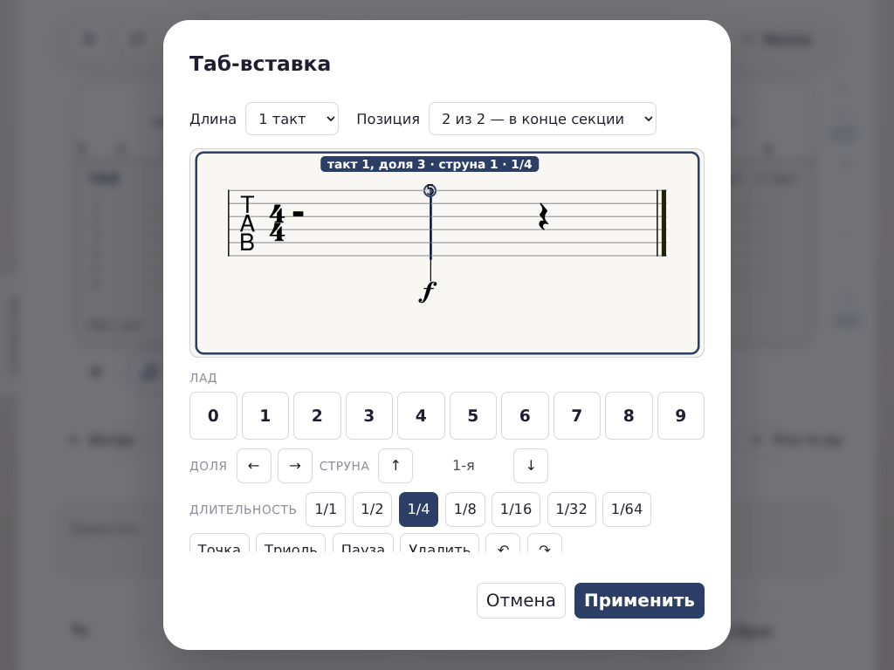

# 0.675 · курсор без автоперехода

**2026-10-22.** Доработка текущей таб-вставки, без нового режима. [Решение владельца](../../../specs/tab-insert/approved-decisions.md): убрать автопереход, стрелками двигаться на выбранную длительность.

## Как теперь вводить

- **Цифра ставит лад, курсор остаётся на месте.** Это одинаково для клавиатуры и экранных цифр. Ни через 0,6 секунды, ни позднее сам он не уходит.
- Для следующей ноты нажмите **→**. При выбранной четверти это следующая четверть, при восьмой — следующая восьмая. **←** возвращает на такую же длительность. Точка и триоль учитываются; шаг не округляется к шестнадцатой.
- На границе вставки курсор останавливается: не выходит наружу и не делает укороченного последнего шага. В пустом такте 4/4 с четвертями: 1 → 2 → 3 → 4, дальше остаётся на четвёртой доле.
- **1 → 2 быстро подряд = лад 12**, одна нота и одно действие отмены. Перемещение курсора разрывает склейку цифр: «1, →, 2» — две отдельные ноты, не лад 12.
- Для созвучия достаточно **↑/↓ и цифры**: возвращать курсор после каждой ноты больше не нужно.

## Что выявила проверка кликов и пустого стана

| Было | Исправлено и проверено |
| --- | --- |
| Пока нет нот, геометрию струн получить не из чего; маркер оказывался в середине стана | Берём границы шести линий такта alphaTab. При открытии пустой вставки маркер стоит **на нижней, шестой струне**, вертикальная линия пересекает все шесть струн |
| В пустом такте одна длинная пауза; клик почти в любом месте выбирал её начало | Клик и маркер используют общую шкалу внутри своего такта с опорой на его конец. Теперь можно выбрать пустое место правее начала |
| Клик по последней 1/64 такта отбрасывал к началу последней шестнадцатой | Точный якорь существующей ноты не ограничивается сеткой пустого места; из близких якорей выбирается ближайший. Воспроизведение: [3.9375 → 3.75 до исправления](last64-before-fix.txt), после исправления точное 3.9375 на всех трёх размерах |
| Пересчёт номера струны при клике был обратным | Клик по каждой из **всех шести нарисованных линий** выбирает правильную физическую струну. Введённый лад появляется на ней |
| При нескольких системах клик выбирал границы битов только по горизонтали | Учитываются и координата по вертикали, и номер такта. Проверены 1–4-й такты, в том числе пустые |
| На пустой вставке стрелки меняли число, но линия могла стоять на месте: был только один временной якорь | Добавлен якорь конца такта. Маркер заметно перемещается вправо и влево ещё до ввода первой ноты |

**Как выглядит пустая вставка:** цветное колечко — место ввода, а не цифра «0» и не записанная нота. Чёрный знак внутри такта — пауза. Ни одной ноты в данных ещё нет.

### Пустая вставка, 390 px



### После клика по первой струне на третьей доле, ещё без ввода



### После цифры 5: курсор остался на ней, 1024 px



[Пустая вставка 1024 px](empty-1024.png) · [Ввод 390 px](typed-390.png) · [Четыре такта 390 px](four-bars-390.png) · [Ввод 1280 px](typed-1280.png).

## Что именно протестировано

Новый постоянный тест `dev/tests/b12-tab-cursor-browser.js` — **112 ok / 0 FAIL**:

- Размеры **390×844**, **1024×768**, **1280×900**. На двух сенсорных размерах клики по стану выполняются настоящими touch-событиями Chromium; на 1280 — мышью.
- Пустая вставка: шесть реальных SVG-линий, видимая вертикаль и точка на шестой струне, отсутствие нот. Ожидаемые координаты берутся из **нарисованных SVG-прямоугольников**, не из тестируемой функции геометрии.
- Стрелки до ввода: маркер действительно идёт по экрану; начало и конец не пересекаются.
- Клик по каждой струне, затем ввод на выбранной позиции. После ввода пауза 850 мс подтверждает отсутствие таймера автоперехода.
- Маркер совпадает с независимыми `noteHeadBounds` alphaTab **с погрешностью меньше 2 px** по обеим координатам.
- Двузначный лад 12, его один шаг Undo, отсутствие самоперехода.
- Шаги 1/4, 1/8, 1/16, 1/64, четверть с точкой, восьмая триоль, восьмая с точкой и триолью. Для дробей допустима только погрешность арифметики менее 0,00000001 доли, не округление к сетке.
- Разрыв склейки цифр стрелкой; клик и ввод во всех четырёх тактах/системах; попадание в последнюю 1/64 такта без потери точности.

[Все проверки и измерения](checks.json) · [лог 112 проверок](cursor-tests.txt).

### Соседние сценарии

- Прежний живой стенд ввода/курсора обновлён под ручной переход: **46 ok / 0 FAIL**, [лог](legacy-input-tests.txt), [измерения](legacy-input-checks.json).
- Сценарий телефона «Ми–Соль–Ля–Си → Em», история, сохранение/открытие и реальный звук: **33 ok / 0 FAIL**, [лог](touch-regression.txt). Между четырьмя нотами добавлены три явных нажатия →. Артефакты и подсчёт касаний 0.674 сохранены как история, не переписаны задним числом.
- Тест повторного открытия теперь выбирает файл настоящим FileChooser; две цифры нажимаются без искусственной прокрутки между ними. Это исправления стенда, не изменение формата песни/импорта.
- Полный прогон **первого кандидата** (`c125bf9d7f00cc88772098b20c72658fa488bb059e3107f3f50be611a377c8d0`), **151 тестовый файл**, три процесса, 652 с: **150 ok / 1 FAIL**. Единственный сбой — старый `b99-harmony-browser`, проверка заливки аккордовых ячеек. Отдельный повтор того же теста на том же HTML: **ALL OK**, без изменения приложения или этого теста. Итоговое покрытие первого кандидата **151/151**; это **не второй чистый полный прогон**. Затем добавлен тест последней 1/64, он обнаружил ограничение клика к сетке. После узкого исправления выбора ближайшего якоря/границы выполнены заново на **финальном HTML**: **112/0**, **46/0**, **33/0**, `page-integrity` и SW-гейт **ALL OK**. Полные 151 файл после этой последней правки заново не запускались. [Первичный результат](regression-initial.json), [первичный лог сбоя](b99-harmony-initial.txt), [лог повтора](b99-harmony-retry.txt), [сводка с повтором](regression.json).
- Финальные гейты: [page-integrity](page-integrity-final.txt), [SW/версия](sw-final.txt).
- Синтаксис: 9 исполняемых скриптов, 6 инертных блоков, **0 ошибок**, [лог](syntax-check.txt). Семь встроенных неисполняемых payload, включая шрифт, побайтово совпадают с 0.674; [SHA-256 аудит](inert-payload-audit.json). MPL-уведомления сохранены.

## Сборка и повторение

- Видимая версия **0.675**, кэш **struchord-v675**.
- `STRUCHORD.html`: **5 400 732 байт**.
- SHA-256: `dacf7dcc832a7d03eaa6869d52eb5c43a607ee9d6c71a6717335a153658230cc`.

```bash
bash dev/tools/setup-acceptance.sh
# При работающем HTTP-сервере приложения на 8000:
B12_CURSOR_RESULTS=dev/bench/results/tab-cursor-0.675 node dev/tests/b12-tab-cursor-browser.js
node dev/tests/b12-tab-touch-browser.js
bash dev/run-tests.sh
```

Без `B12_CURSOR_RESULTS` новый тест не создаёт артефактов в репозитории. Кадры — настоящие снимки браузера, без дорисовки. Физические iPhone/iPad и Safari не проверялись. Библиотека alphaTab, музыкальная модель, GP/MIDI-экспорт и звуковой движок не менялись. **Вся волна B-12.12 остаётся открытой.**
