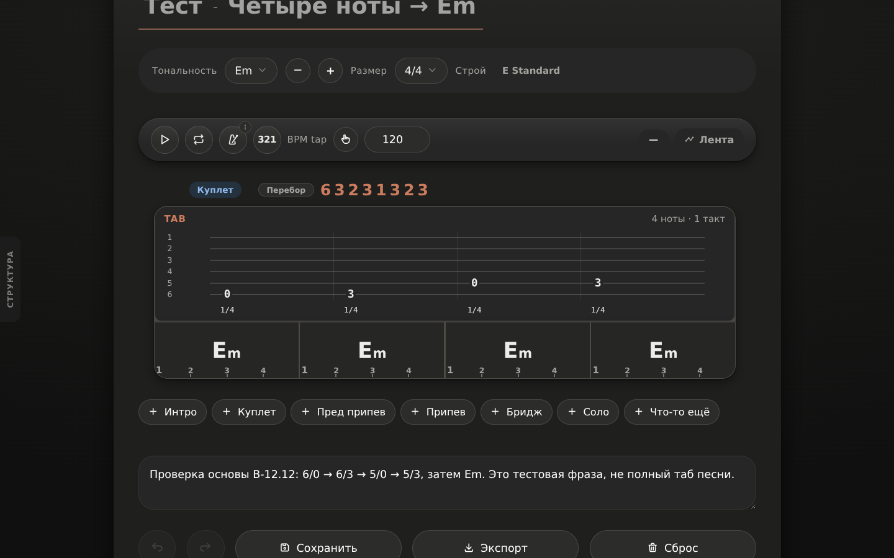
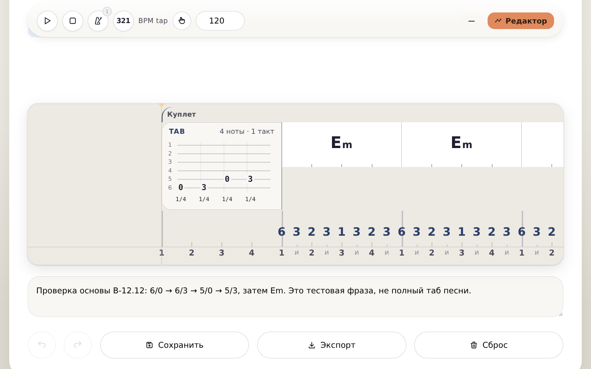

# B-12.12 · 0.668 — отчёт промежуточного этапа

**2026-10-20 · Основа исправлена и проверена на тестовой фразе. Вся волна T1–T19 НЕ завершена.**

Работа выполнена относительно `bce671d` / фактической 0.667. Исходные документы сохранены без изменений: [полное ТЗ](../../../specs/tab-insert/original-v1.0-2026-10-19.md) и [проверка 0.666](../../../specs/tab-insert/review-0.666-2026-10-19.md). [Решения владельца по R8](../../../specs/tab-insert/approved-decisions.md) включают весь дальнейший объём, в том числе MIDI.

## Сборка и проверки

| Показатель | Результат |
|---|---|
| Версия / SW | `0.668` / `struchord-v668` |
| Схема `.struchord` | 9, без подъёма |
| SHA-256 HTML | `fbcdbdde08bab1c09d08a61b1c500e4b6b574a895b9ee93100c78b148b5c33ae` |
| Размер HTML | 5 319 513 байт |
| Проверка синтаксиса | 9 скриптов + 6 инертных JS-блоков, 0 ошибок; base64-шрифт Bravura не компилируется как JS |
| Новый тест модели/диалога | **62 ok / 0 FAIL**, [b12-tab-insert-foundation.js](../../../tests/b12-tab-insert-foundation.js) |
| Живой Chromium | **55 проверок, 0 падений**, [воспроизводимый стенд](../../tab-insert-foundation-live.js) |
| Полный `dev/run-tests.sh` | **147 ok / 0 FAIL**, код завершения 0; [полный журнал](regression.txt) |
| Браузер живого стенда | HeadlessChrome/149.0.7827.0 |

Полный прогон исходной 0.667 отдельно дал 143 успешных файла и 3 отказа запуска Chromium из-за отсутствовавшей `libnspr4.so`; после восстановления библиотек все три повтора прошли. Это **не** выдаётся за непрерывный зелёный прогон. Для текущей сборки полный корпус выполнен заново без остановок с библиотеками и с **текущей**, не базовой, страницей на порту 8000: все 147 файлов прошли, включая браузерные проверки GP5/GPX, Live Server, гармонию, «Партии», старые песни, лаборатории и новый TAB-тест. Один промежуточный прогон остановлен перед обнаруженным исправлением смены размера и не считается результатом финального кода.

В 0.667 уже имелись чтение `sq.beats`, запись полей TAB, исправленный числовой индекс струны и часть расчёта экспортного смещения. Они не объявляются заново написанными по отчёту о 0.666. В 0.668 проверены результаты и устранены оставшиеся разрывы: локальный рендер, пустые `events` в загрузчике/планировщике, согласованная нормализация, история, диалог, звук и смена размера.

## Что действительно проверено

- TAB — отдельная полная строка редактора, не узкая клетка; локальная перерисовка сохраняет ноты и геометрию.
- Внутри — шесть струн в ориентации GP: низкая шестая внизу. Лады и подписи длительностей не растягиваются вместе с SVG.
- У вставки четыре единицы 4/4, у секции TAB + четыре Em — **20**, а не 16. Ход по повторениям заканчивается.
- Реальный FileReader → редактирование → настоящий экспортный Blob → перезагрузка страницы → чтение сохранённого результата; струны, лады, позиции и длина не теряются. Стенд перехватывает `URL.createObjectURL` и клик ссылки, чтобы забрать Blob без системного диалога скачивания; сам `exportStruchordFile` не заменён. Его содержимое записано в приложенный `.struchord`.
- Диалог — fixed overlay в обеих темах; список обновляется с четырёх до пяти строк. До «Применить» песня не меняется. Отмена сохраняет исходник. Применение — один Ctrl+Z/Ctrl+Y.
- Закрытие диалога больше не создаёт скрытую правку аппликатуры аккорда под ним: случайное наведение подавлено до следующего действия указателя. Проверено с неподвижной мышью и паузой 500 мс до Undo и Redo.
- Реальные кнопки переноса/копии в пределах секции и два последовательных клавиатурных Undo/Redo. Отдельные действия быстрее debounce не сливаются.
- Изменение длительности сдвигает хвост. Удаление одной струны созвучия не удаляет время, удаление последней — сдвигает хвост. Переполнение добавляет только один такт либо отклоняется; сокращение не отрезает ноты.
- Смена размера песни/секции пересчитывает единицы и целотактовую длину, не создаёт аккордовые `events` у TAB. На превышении четырёх тактов вся операция отвергается без изменений. Сохранение после 4/4 → 6/8 снова открывается; Undo возвращает размер и ноты вместе.

## Измерения

Фикстура: [исходные четыре ноты перед Em](../../../fixtures/b12-tab-insert.struchord). 120 BPM, 4/4, E Standard, 6/0 → 6/3 → 5/0 → 5/3, затем четыре такта Em с перебором. Это тестовая фраза, **не полная песня Going to the Run**.

| Режим | Обе темы, оба размера окна | Размер TAB | Высота контейнера |
|---|---|---:|---:|
| Редактор | 1440×900 и 1280×800 | 935.5 × 185 px | 187 px |
| Лента | 1440×900 и 1280×800 | 260 × 190 px | 190 px |

При текущем автоматическом UI-масштабе все четыре лада и счётчик внутри рамки. Для ладов дополнительно проверены попадание в viewport и отсутствие перекрывающего элемента через `elementFromPoint`. Снимки сделаны после прокрутки к вставке; `scrollY` сохранён в [measurements.json](measurements.json), кадры не обрезались и не дорисовывались.

- Открытие тестового файла: **100.4 мс**.
- Повторное открытие скачанного файла: **89.5 мс**.
- Метод: FileReader → новый DOM вставки → два `requestAnimationFrame`, из уже запущенного приложения; его первоначальная стартовая анимация исключена.
- Это замер **одной небольшой фикстуры на этой машине**, не p95 для больших песен и не универсальная гарантия 300 мс.
- Время ввода четырёх нот и бюджет ≤50 мс **не измерялись**: прямой ввод ещё не реализован. Условие «четыре ноты за ≤4 с» не принято.

### Настоящий звук, не только вызов функции

Play запущен настоящей кнопкой отдельно в редакторе и ленте, в независимых страницах. Оригинальный `pluckString` не заменён заглушкой: создаются `AudioBufferSourceNode`, а AudioWorklet снимает PCM с мастер-выхода. Высота оценена периодом нормированной автокорреляции, а не самым громким обертоном.

| Нота | Частота, переданная голосу | Частота периода PCM, оба режима | Начало от начала TAB |
|---|---:|---:|---:|
| 6/0 · E2 | 82.407 Hz | 82.276 Hz | 0 с |
| 6/3 · G2 | 97.999 Hz | 98.438 Hz | 0.5 с |
| 5/0 · A2 | 110 Hz | 110.25 Hz | 1 с |
| 5/3 · C3 | 130.813 Hz | 131.25 Hz | 1.5 с |

Написанная четверть — 0.5 с. До отметки **2 с** создаются только четыре TAB-голоса, щипки Em начинаются на 2 с. Проверены ненулевой PCM, порядок, частоты, длительности, переход подсветки **блока** TAB → Em и прекращение новых звуков после Паузы/Стопа. Звуковые хвосты гитарного тембра не объявляются математической тишиной.

Найденные при проверке ошибки исправлены: отсутствовавший `pan: 0` вызывал отказ AudioParam; холодный расчёт следующей аппликатуры в ленте ставил первую ноту примерно на 359 мс в прошлом. Теперь TAB ставится в аудиоочередь **до** UI-превью; в финальном прогоне первая нота поставлена заранее на 111.3 мс в редакторе / 108.4 мс в ленте.

Точки, триоли, паузы, одновременные струны и Drop D + каподастр 2 дополнительно проверены по значениям аргументов планировщика в модельном тесте. Это не подменяется утверждением о ручном прослушивании всех строёв/режимов. Подсветка отдельных нот — следующий этап.

## Явная матрица T1–T19

«Проверено» здесь относится к указанному сценарию 0.668, а не ко всей функции из исходного ТЗ.

| № | Статус этого этапа | Основание / что остаётся |
|---|---|---|
| T1 · невидимая вставка | **Проверено** | Полный и локальный рендер, измерения, 8 кадров с четырьмя нотами |
| T2 · время вставки | **Проверено** | TAB=4, секция=20; конечный ход/повторы, лента, аудио, смена размера |
| T3 · сохранение | **Проверено** | Скачанный Blob содержит type/beats/notes/пустые events, включая новые ноты после редактирования |
| T4 · открытие | **Проверено** | Настоящий FileReader после перезагрузки; снимок повторного открытия; старые песни — регрессионный корпус |
| T5 · ноты в GP | **Не принято** | В этом этапе нет новых GP5/GPX-файлов со вставкой и их независимой проверки |
| T6 · клавиатура | **Не реализовано** | Курсор/цифры/стрелки/двузначный лад/Undo ввода — следующий этап |
| T7 · клик по струне | **Не реализовано** | Клик пока открывает диалог; не выдаётся за ввод курсором |
| T8 · модалка/стиль | **Проверено** | fixed overlay, тематические элементы, два снимка диалога |
| T9 · обновление списка | **Проверено** | Кнопка +Ноту: 4→5 строк, черновик, Отмена/Применить |
| T10 · индекс струны | **Проверено** | DOM-селектор первой/шестой струны даёт 5/0, без двойного пересчёта |
| T11 · ориентация/GP-струны | **Частично** | Экран и звуковая высота согласованы; нумерация в GP ещё не принята экспортным файлом |
| T12 · длительности | **Проверено** | 1 единица 4/4 подписана 1/4, доли/точка/триоль/6/8 проверены по значениям |
| T13 · Undo перемещения | **Проверено** | Реальные кнопки переноса/копии, отдельные Ctrl+Z/Y; мутации внутри dispatch |
| T14 · нужное место вставки | **Не принято** | API `beforeSqId` уже существовал; обычный UI ещё не даёт весь требуемый выбор места, drag и межсекционные операции |
| T15 · звук | **Проверено на фикстуре** | Настоящие источники/PCM в двух видах, четыре ноты перед Em без аккомпанемента внутри TAB |
| T16 · dev-доступ к «Партиям» | **Не принято этим этапом** | Код/данные/alphaTab/тесты сохранены; фактический dev-вход ещё требует отдельной UI-проверки/доведения |
| T17 · экспортные смещения | **Не принято** | Часть расчёта через getSquareBeats уже была в 0.667; требуется сквозная проверка плана/файлов, не переписывание вслепую |
| T18 · строй экспорта | **Частично** | Звуковой планировщик читает строй/капо песни; GP-строй и струны ещё не приняты файлом |
| T19 · подсказка/пустой TAB | **Частично** | Читаемая строка «Нет нот» есть; первой трёхшаговой подсказки ещё нет |

**Дополнительные требования полного ТЗ, не закрытые этим этапом:** drag и копия между секциями, контекст/подпись, транспонирование с общей октавной коррекцией/исходной тональностью/предупреждением, экспорт GP5/GPX/MIDI format 1 и mute, скрытие GP/MIDI в обычном выборе при сохранённом техническом импорте, первая подсказка, подсветка отдельных нот, бюджет ввода и весь Going to the Run. Успех старых GP-тестов «Партий» не закрывает экспорт новых вставок.

## Файлы и изображения

- [Скачанная песня со вставкой](four-notes-before-em.struchord).
- [Она же после перезагрузки](reopened-1440x900.png).
- Диалог: [светлый](modal-light-1440x900.png), [тёмный](modal-dark-1440x900.png).
- Редактор: [light 1440×900](editor-light-1440x900.png), [dark 1440×900](editor-dark-1440x900.png), [light 1280×800](editor-light-1280x800.png), [dark 1280×800](editor-dark-1280x800.png).
- Лента: [light 1440×900](timeline-light-1440x900.png), [dark 1440×900](timeline-dark-1440x900.png), [light 1280×800](timeline-light-1280x800.png), [dark 1280×800](timeline-dark-1280x800.png).
- [Исходные числовые измерения и результаты всех 55 проверок](measurements.json).

### Редактор, тёмная тема, 1440×900



### Лента, светлая тема, 1280×800



## Повторить

Из корня репозитория (зависимости из lockfile):

```bash
PUPPETEER_SKIP_DOWNLOAD=1 npm ci --ignore-scripts --no-audit --no-fund
bash dev/bench/ensure-chromium-libs.sh
python3 -m http.server 8000 --bind 0.0.0.0
# В другом терминале:
node dev/tools/check-html-syntax.js
node dev/tests/b12-tab-insert-foundation.js
node dev/bench/tab-insert-foundation-live.js
LD_LIBRARY_PATH=/tmp/al2023/lib bash dev/run-tests.sh
```

Для другого адреса: `STRUCHORD_URL=http://127.0.0.1:8000/STRUCHORD.html`. Стенд использует настоящий Chromium из `@sparticuz/chromium`, не требует установленного Guitar Pro; именно поэтому GP/DAW-приёмка остаётся открытой. `B12_TAB_AUDIO_ONLY=1` запускает только звуковые проверки и не создаёт полный отчёт. Новый полный запуск заменяет `measurements.json`; при отказе пишет `failure.json`, чтобы старый успешный JSON не маскировал новый провал.
