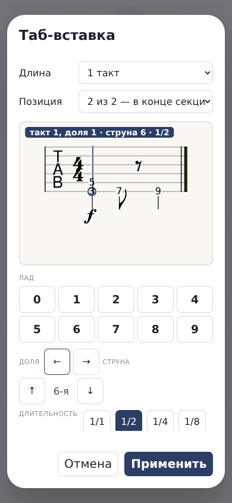
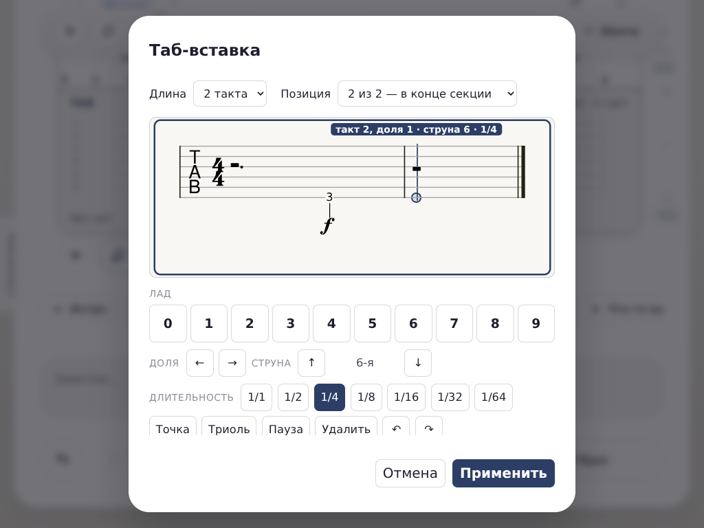

# 0.677 · ←/→ между нотами и паузами, расширение до четырёх тактов

**2026-10-22.** Владелец попросил переходы вправо/влево как в GP и через R8 выбрал автоматическое добавление такта в конце вставки. Это заменяет выбранную ранее арифметическую навигацию по записанным нотам 0.675. +/− из 0.676 и остальные команды не меняются.

## Что теперь делает курсор

- **На записанной ноте или паузе** ←/→ выбирают соседнюю ритмическую позицию. Созвучие — одна позиция, независимо от числа струн. Длина текущей ноты больше не определяет расстояние до предыдущей.
- **Между нотами** учитываются паузы отрисовки. В пустом месте остаётся шаг по выбранной длительности с точкой/триолью; он не перескакивает следующую записанную ноту, не попадает внутрь предыдущей длинной ноты и не пропускает начало следующего такта.
- При клике внутрь длинной ноты ← возвращает к её началу, → — к концу.
- **В конце вставки → добавляет ровно один целый такт** и ставит курсор в его начало. Максимум — четыре такта. На пределе длина, ноты и история не меняются.
- Клавиатура и экранные стрелки вызывают один обработчик. Выбранная струна сохраняется; движение разрывает склейку цифр в двузначный лад. Ввод цифры по-прежнему **не продвигает курсор**.
- Стрелки не записывают ноты или паузы. Обычное перемещение не создаёт шаг Undo. **Расширение — один шаг Undo**, с восстановлением длины и позиции; Redo возвращает сохранённое состояние. Ввод ноты в новом такте — следующий, отдельный шаг.

### Пример, из-за которого начата правка

```text
время 0:   половинная, две струны
время 2:   восьмая
время 2.5: восьмая пауза
время 3:   четверть
```

Раньше ← из 2 давала **1.5**, то есть попадала внутрь половинной. Теперь проход влево: **3 → 2.5 → 2 → 0**, вправо: **0 → 2 → 2.5 → 3**. Следующая → из 3 добавляет второй такт, курсор **4**, длина **8** в единицах 4/4.

[Воспроизведение ошибки до изменения](before-fix.txt).

## Реальные кадры браузера

### Телефон 390 px: после возврата с восьмой на половинную



### Планшет 1024 px: → добавила второй такт



[Расширение 390 px](extended-390.png) · [Смешанный ритм 1024 px](mixed-1024.png) · [Смешанный ритм 1280 px](mixed-1280.png) · [Расширение 1280 px](extended-1280.png).

## Проверки

Новый постоянный `dev/tests/b12-tab-navigation-browser.js`: **247 ok / 0 FAIL**, [состояния и измерения](checks.json), [лог](navigation-tests.txt).

На **1280×900, 390×844 и 1024×768** проверены:

- клавиатурный проход и отдельный проход экранными стрелками; на сенсорных размерах — настоящие touch-события Chromium, на 1280 — мышь;
- исходный пример половинная/восьмая, несколько струн, явная пауза и обратный проход;
- сохранение струны, совпадение маркера с настоящими `noteHeadBounds` alphaTab **менее 2 px**;
- четверть с точкой, триольная восьмая, триольная пауза и точное дробное время;
- пустые промежутки, клик внутри длинной ноты, большой шаг перед короткой нотой;
- в пустом такте — четверть, 1/64, точка и триоль, без записи нот/пауз;
- переход между уже существующими тактами без нового действия истории;
- **6/8**: правильные единицы, новый такт на 6, а не на 4, Undo/Redo длины и курсора;
- расширение 1→2→3→4, отказ от пятого без изменения истории, поочерёдные Undo/Redo;
- видимый курсор в новом пустом такте, первая записанная нота и отсутствие самоперехода спустя 850 мс;
- независимая отмена введённой ноты и расширения, разрыв склейки цифр;
- до «Применить» исходная вставка не меняется; применение сохраняет новую длину и ноты; «Отмена» повторной правки не сохраняет расширение.

### Регрессии

- `b12-tab-cursor-browser`: **112 ok / 0 FAIL**, [лог](cursor-tests.txt). Обновлено ровно одно устаревшее ожидание на каждый размер: вместо упора в конец одного такта проверяется переход во второй и возврат Undo. Остальные проверки кликов/струн/геометрии сохранены.
- `tab-editor-live`: **46 ok / 0 FAIL**, [лог](legacy-tests.txt).
- Полный набор **153 тестовых файла**, три процесса, **507 с**: **152 ok / 1 FAIL**. Единственный сбой — прежний `b99-harmony-browser` (заливка аккордовых ячеек), не новая навигация. Одиночный повтор на том же финальном HTML, без изменения приложения и теста: **ALL OK**. Итоговое покрытие **153/153 после повтора**, а не второй чистый полный прогон. [Первичный результат](regression-initial.json), [лог сбоя](b99-harmony-initial.txt), [лог повтора](b99-harmony-retry.txt), [сводка](regression.json).
- В составе полного прогона на финальном HTML: **107/0** проверок +/− ([лог](b12-tab-duration-keys-browser-regression.txt)); **33/0** сенсорного ввода, истории, сохранения/открытия и реального звука ([лог](b12-tab-touch-browser-regression.txt)). Новый тест навигации в полном прогоне также прошёл **247/0** ([лог](b12-tab-navigation-browser-regression.txt)).
- Синтаксис: 9 скриптов, 6 инертных блоков, **0 ошибок**, [лог](syntax.txt).

## Что изменено технически

`tabAtMove` на записанной позиции использует ритмические начала из собственной раскладки тактов и границы записанных длительностей; точки внутри удерживаемой ноты исключаются. В пустоте шаг ограничивается соседними нотами и границей такта. Расширение проходит через существующий `tabInsertSetBeats`, то есть тот же лимит 1–4, черновик и история.

В **локальные снимки истории диалога**, не в модель песни, добавлена позиция курсора. Она восстанавливается при Undo/Redo **изменения длины**, чтобы после отмены расширения курсор не оставался за концом. Обычная отмена правки ноты не получила нового поведения перемещения. При переходе на явно записанную паузу палитра теперь подтягивает её длительность/знаки; сгенерированные для рисунка паузы не меняют выбор длительности для ввода в пустом месте.

Семь встроенных неисполняемых payload (включая шрифт) побайтово совпадают с 0.676; [аудит SHA-256](inert-payload-audit.json). MPL notices сохранены. Формат `.struchord`, музыкальная модель, звук, GP/MIDI-экспорт, Ctrl+Y, Home/End и команды Insert/Delete не переписывались. Исторические отчёты не изменены.

## Сопоставление с GP и пределы проверки

Официальная документация GP8 определяет стрелки как предыдущую/следующую позицию или такт, а правую стрелку в конце — как способ добавить такт. [17](https://www.guitar-pro.com/docs/gp8/basics/first-steps/navigate) [16](https://www.guitar-pro.com/docs/gp8/score/bars)

**Настоящий Guitar Pro здесь не запускался.** Реализована согласованная навигация нашей отдельной вставки: между записанными позициями и с расширением, но с выбранным владельцем правилом шага в пустоте и лимитом четырёх тактов. Это не заявление о полной идентичности редактора/всех пограничных сценариев GP. Физические телефоны, Windows/macOS и Safari не проверялись. B-12.12 остаётся открытой.

## Сборка и повторение

- Видимая версия **0.677**, кэш **struchord-v677**.
- `STRUCHORD.html`: **5 403 446 байт**.
- SHA-256: `a4a99fa1f0c162a0d644b5bc467268054132671627bd189c9cfcf79756010e46`.

При установленном окружении `bash dev/tools/setup-acceptance.sh` и HTTP-сервере приложения на 8000:

```bash
B12_NAV_RESULTS=dev/bench/results/tab-navigation-0.677 node dev/tests/b12-tab-navigation-browser.js
node dev/tests/b12-tab-cursor-browser.js
node dev/tests/b12-tab-duration-keys-browser.js
bash dev/run-tests.sh
```

Без `B12_NAV_RESULTS` новый тест не создаёт артефактов в репозитории. Кадры — настоящие снимки браузера, без дорисовки.
