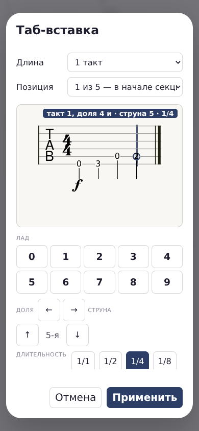
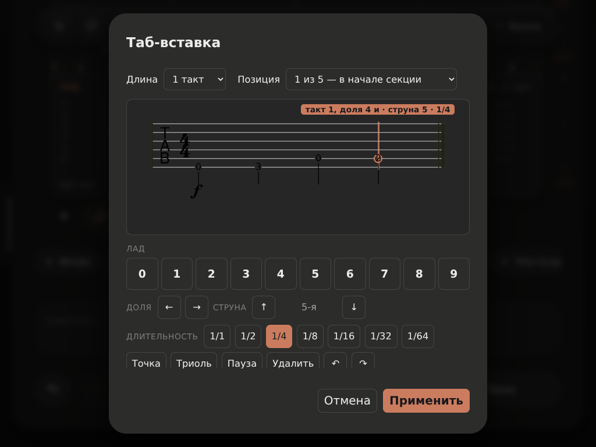
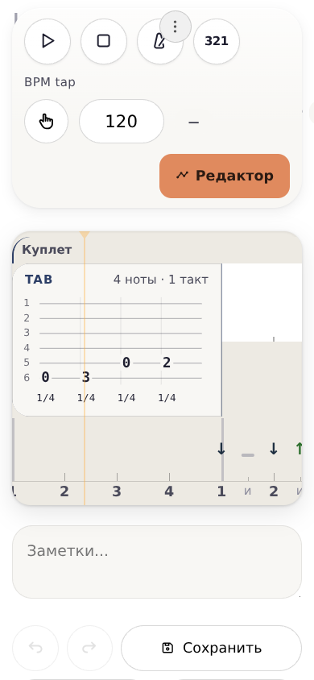

# 0.674 · таб-вставка: удобство на телефоне и планшете

## Что изменилось

1. **Лады 0–9 — под станом.** На 390 px это два ряда по пять кнопок; на 1024 px — один ряд. Все десять кнопок доступны пальцем, не меньше 44×44 px. Сенсорный планшет больше не считается компьютером только из-за ширины экрана. На компьютере с мышью панель по-прежнему скрывается.
2. **Лады 10–24:** быстро нажмите две цифры подряд: **1 → 2 = 12**, **2 → 4 = 24**. Вторая цифра должна прийти в течение 0,6 секунды. Две цифры — одна нота и один шаг отмены. Системная клавиатура для этого не нужна.
3. **Созвучие — без нового режима.** Вернитесь на долю первой ноты, выберите другую струну и введите лад. С клавиатуры: ←/→, затем ↑/↓ и цифра; на панели — те же стрелки и кнопки цифр. Для четверти после автоматического перехода назад нужно **четыре нажатия ←**: курсор двигается по маленьким шагам сетки, а не по целым четвертям. Можно сразу нажать нужную ноту на стане и затем сменить струну. Способ добавлен в подсказку; в проверке экранными кнопками получено три ноты на одной доле.
4. Вместо «доля 4.75» — **«доля 4 и»**, на начале доли — «доля 4». Время самих нот не менялось.
5. Рекламная строка **«rendered by alphaTab» скрыта только в рисунке этого редактора**. MPL-2.0 не требует этой строки в интерфейсе; §3.4 требует сохранения лицензионных уведомлений в исходном коде. Исходный бандл, copyright, [LICENSE](../../../../third_party/alphaTab/LICENSE) и [NOTICE](../../../../third_party/alphaTab/NOTICE.md) сохранены.
6. Подпись **«Позиция»** не сжимается и не обрезается. «Применить» и «Отмена» остаются доступны при прокрутке содержимого окна.
7. **Первое применение новой вставки — один шаг истории.** Ctrl+Z убирает вставку целиком, вместе с нотами и выбранным местом. Повторная правка уже существующей вставки отменяется отдельно и не удаляет её.
8. При проходе с нуля обнаружен старый сенсорный блокер: ряд «+ квадрат / Таб» оставался обрезанным до нулевой высоты без наведения мыши. На сенсорном экране он теперь раскрыт постоянно. Во время игры скрывается, как раньше.

## Сценарий, который проверен

**Новая песня → Куплет → четыре аккордовых квадрата → Em с боем «Шестёрка» → перед ним один такт TAB:**

| Нота | Где нажать | Длительность |
| --- | --- | --- |
| Ми2 (E2) | 6-я струна, лад 0 | четверть |
| Соль2 (G2) | 6-я струна, лад 3 | четверть |
| Ля2 (A2) | 5-я струна, лад 0 | четверть |
| Си2 (B2) | 5-я струна, лад 2 | четверть |

Получается **пять квадратов всего: TAB + четыре исходных аккордовых**. Ничего из четырёх не заменено вставкой. В первом из исходных квадратов — Em с боем; остальные аккордовые ячейки остаются пустыми.

### Сколько нажатий на 390 px

| Действие | Нажатия |
| --- | ---: |
| Новая песня + Куплет + три раза «+ квадрат» | 5 |
| Выбрать ячейку, открыть круг, выбрать Em | 3 |
| Снова выбрать Em, «ритм», «Шестёрка», сохранить бой | 4 |
| «Таб», открыть «Позиция», выбрать начало секции | 3 |
| Цифры 0, 3; ↑ на 5-ю струну; цифры 0, 2 | 5 |
| «Применить» | 1 |
| **Итого для человека** | **21** |

**Сама вставка после подготовки песни — 9 нажатий**, из них пять — набор нот со сменой струны. Ещё две прокрутки понадобились при создании секции/квадратов. Пауза после одиночной цифры, чтобы курсор сам перешёл дальше, не считается нажатием.

**Граница проверки:** использован настоящий Chromium с эмуляцией сенсорного экрана, не физический телефон/iPad. Автотест действительно выполнил **20 сенсорных нажатий и две сенсорные прокрутки**. Единственное исключение — выбор пункта в системном списке «Позиция»: браузерный драйвер не передаёт касание во внешнее нативное меню, поэтому именно этот выбор автоматизирован отдельно. В журнале он честно отмечен как `native-select`, а не выдан за успешный touch. Для человека это ещё одно нажатие на пункт, отсюда 21. Цифры нот, смена струны, создание квадратов, выбор Em и боя введены через настоящие элементы интерфейса; готовые ноты в модель не подставлялись.

## Скриншоты

### Телефон, 390×844, светлая тема



[Тёмная тема 390 px](editor-dark-390.png).

### Планшет, 1024×768, тёмная тема



### Результат в «Ленте», 390 px



## Что проверено после применения

| Проверка | Результат / доказательство |
| --- | --- |
| **Звучит перед боем** | При 120 BPM реальные источники Web Audio играют E2/G2/A2/B2 в 0 / 0,5 / 1 / 1,5 с. Первый удар Em — на 2 с, до него аккомпанемент не подмешан. С мастер-выхода снят ненулевой PCM для каждой ноты. [Запись](playback.wav) · [во время TAB](playing-tab-390.png) · [во время Em](playing-em-390.png) |
| **Видна в «Ленте»** | Четыре ноты, за ними бой; бой не рисуется поверх TAB. См. кадр выше |
| **Сохраняется и открывается** | Скачан настоящий Blob `.struchord`, страница перезагружена, файл прочитан настоящим FileReader. Струны, лады, время и длительности совпали. [Файл песни](four-notes-before-em.struchord) |
| **Открывается для правки теми же нотами** | Проверено до и после чтения сохранённого файла. [Редактор после повторного открытия](reopened-editor-390.png) |
| **Ctrl+Z — один шаг** | После набора и установки перед Em одно Ctrl+Z убрало весь TAB. Em, его бой и четыре исходных квадрата остались. Одно Redo вернуло позицию и четыре ноты. Отмена последующей правки вернула старые ноты, а не удалила вставку |
| **Двузначный лад / созвучие** | На панели 1→2 даёт 12; на клавиатуре 2→4 даёт 24; каждый отменяется одним шагом. Экранными кнопками получены три одновременные ноты, клавиатурой — дополнительная одновременная струна |

Запись `playback.wav` снята с настоящего синтеза приложения, не сгенерирована голосовым/музыкальным сервисом. Начало файла соответствует первой ноте, последние секунды — началу боя Em.

## Инженерная проверка

- `dev/tests/b12-tab-touch-browser.js`: **33 ok / 0 FAIL** — [лог](browser-tests.txt), [проверки, геометрия, звуковые события и журнал жестов](checks.json).
- Прежний живой стенд ввода/курсора `dev/bench/tab-editor-live.js`: **46 ok / 0 FAIL** — [лог](legacy-input-tests.txt). Ожидание панели обновлено: учитывается тип устройства, а не только ширина. У headless-браузера тип указателя по умолчанию «неизвестный», поэтому он получает безопасную видимую панель.
- Синтаксис HTML: 9 исполняемых скриптов и 6 инертных блоков, **0 ошибок**.
- **Регрессия 150 файлов: ошибок не осталось** — [итог с повторами](regression.json). Первый полный прогон дал 148/2: два гейта обнаружили несинхронный видимый номер версии в шапке. После его исправления оба пройдены заново; ещё раз пройдены все 33 новых и 46 прежних браузерных проверки на финальном SHA. Это полный прогон плюс точечные повторы, не второй чистый полный прогон. [Первоначальный результат](regression-initial.json) сохранён для прозрачности.
- **Версия:** `0.674`; **кэш:** `struchord-v674`.
- **HTML:** 5 401 533 байт; SHA-256 `b1bb4d3ca5e030ca87c4dae675afa0c02cedb533ddb40dd2f4aca5d5a620bb72`.

### Повторить

Из корня, при работающем HTTP-сервере на 8000:

```bash
bash dev/tools/setup-acceptance.sh
B12_TOUCH_RESULTS=dev/bench/results/tab-touch-0.674 node dev/tests/b12-tab-touch-browser.js
bash dev/run-tests.sh
```

Новый тест входит в обычный `dev/run-tests.sh`; без `B12_TOUCH_RESULTS` не сохраняет файлы в репозиторий. Все скриншоты выше — кадры браузера без дорисовки.

**Это не закрытие всей B-12.12.** Новые музыкальные возможности, режимы, импорт/экспорт, drag и транспонирование этим заходом не добавлялись. Ширина аккордового редактора/ленты не переделывалась: в основном редакторе на телефоне остаётся горизонтальная прокрутка квадратов; полный такт TAB виден в его диалоге и в показанной «Ленте».
